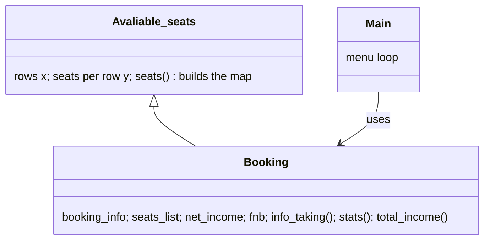

<h1 align="center">🎬 BookYourMovie.com</h1>

<p align="center">
  <b>A cinema ticket-booking system in Python: a live seat map, seat reservation with buyer details, zone-based ticket prices, a food-and-drinks add-on, and box-office statistics.</b>
</p>

<p align="center">
  
  
  
  <a href="https://youtu.be/LICyBeadGwI"></a>
</p>

---

## ✨ Features

▶️ **Watch the demo:** [youtu.be/LICyBeadGwI](https://youtu.be/LICyBeadGwI)

| Menu | What it does |
|---|---|
| **1. Show seating** | Draws the hall row by row (A, B, C…) with green **S** for free seats and red **B** for booked ones |
| **2. Book a seat** | Pick a seat like `C7`, see its price, enter name, gender, age and phone, add a **popcorn & coke combo** ($5) |
| **3. Booking details** | A neatly aligned table of every booking |
| **4. Statistics** | Tickets sold, % of the hall booked, current income, maximum possible income, food & beverage income |

**Pricing rule:** in small halls (60 seats or fewer) every seat is $10; in bigger halls the front half costs **$10** and the back half **$8**.

## 🧠 How it works



- **`Avaliable_seats`** asks for the hall size and builds the seat map as a grid of lists.
- **`Booking`** inherits the map and adds the box office: validating the seat code, refusing double bookings, pricing by row, recording each buyer, and computing statistics.
- **`Main.py`** is the menu loop that ties it together. ANSI colour codes make free and booked seats readable in the terminal.

The use-case diagram is in [`use_case_diagram/`](use_case_diagram/).

## ▶️ Run it

```bash
python Main.py
```

Enter the number of rows and seats per row when asked. No libraries to install.

## 🎯 What this project shows

`OOP and inheritance` · `2-D data structures` · `input validation` · `business rules (pricing tiers)` · `aggregate statistics` · `formatted CLI output` · `use-case modelling`

## 💬 Interview questions this project answers

<details>
<summary><b>How do you prevent two people booking the same seat?</b></summary>

Every booked seat code is kept in `seats_list`; a new booking is refused if its code is already there. In a real system the seat would be a database row with a unique constraint, reserved inside a transaction, so two requests at the same instant can't both succeed.
</details>

<details>
<summary><b>How is "maximum possible income" calculated?</b></summary>

Capacity is rows × seats. With tiered pricing, it's (front-half seats × $10) + (back-half seats × $8): the revenue if every seat sold, which lets the manager compare actual sales against the ceiling.
</details>

<details>
<summary><b>How would you turn this into a real booking website?</b></summary>

Move the seat map and bookings into a database, expose booking as an API, hold a seat for a few minutes during payment, and confirm it only when payment succeeds.
</details>

## 🛠️ Next steps (honest)

- **Persistence:** bookings live in memory; a database would keep them between runs.
- **Seat validation:** the seat check relies on a broad `try/except`; an explicit pattern check (`^[A-Z]\d+$`) gives clearer errors.
- **Cancellations and refunds**, and several shows or screens.
- **Tests** for pricing and the statistics.

---

<p align="center"><sub>Built by <a href="https://github.com/abhishekvtiwari">Abhishek Tiwari</a> · Python project from the Edyoda programme</sub></p>
